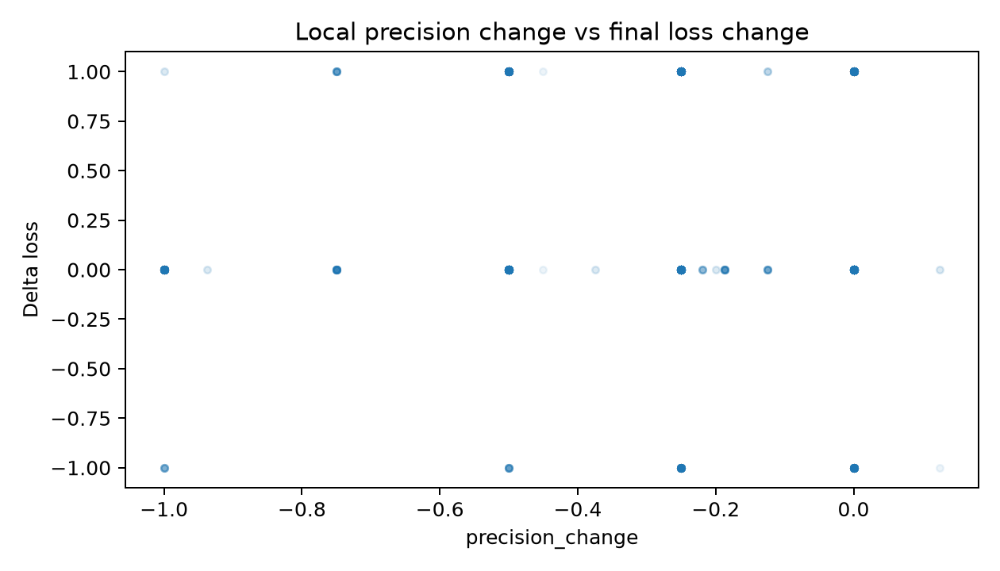
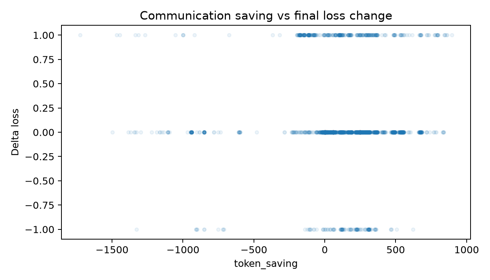
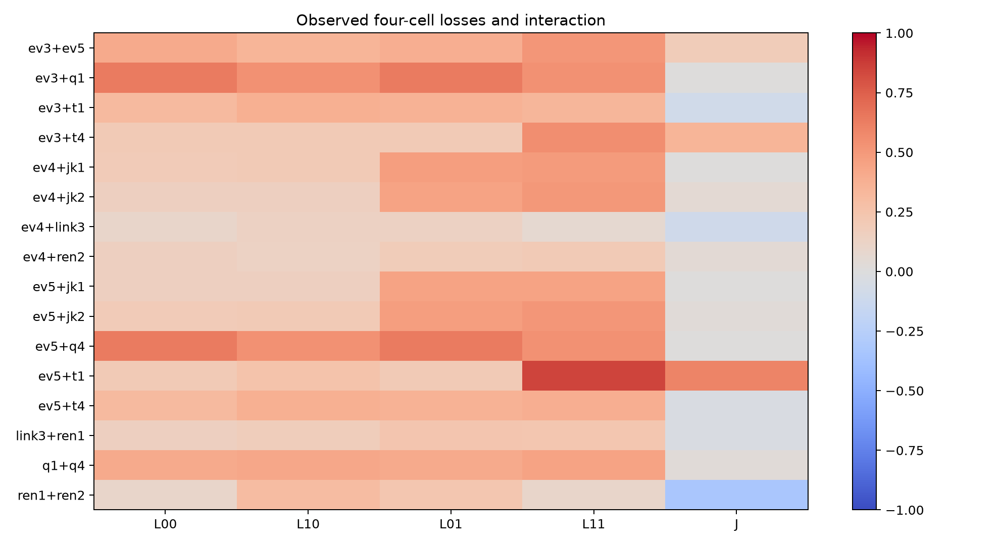
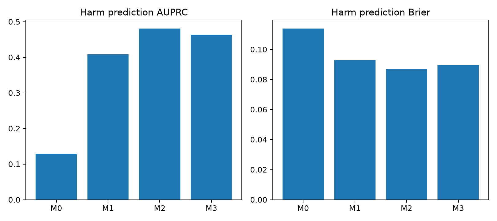

# 固定 Agent workflow 消息依赖预实验报告

状态：预实验完成。

1. 实际完成 200 个正式世界、400 个查询、3600/3600 个条件。正式实际节点请求 5127（含碰撞诊断），两轮 smoke 成功请求共 320，另有 64 次基础设施失败请求；总预算账本 5511 次请求、371205 个生成 token、0.4825 GPU 小时（Slurm 实际占用 1,737 秒，含失败与探测）。模型 Qwen/Qwen3.5-4B，revision `851bf6e806efd8d0a36b00ddf55e13ccb7b8cd0a`，单张 NVIDIA B300，BF16、无量化、vLLM 0.25.1+cu129，关闭 thinking，温度0，固定 JSON 约束解码。文件 hash/模板见 configs/model_identity.json。
2. 按预声明的本侧事实 precision，观察到质量反转 0 条；仅节约 token 而损失增加 226 条。二者不混称。所有样本 precision/recall 变化均在 sample_metrics.csv；高抽取 precision 可造成局部质量指标天花板。
3. H1 有探索性支持：entity_join 的 e1 删除关联键，在无需项目关联时平均 ΔL=0，要求项目关联时 ΔL=0.575；同世界差值 0.575，95%区间 [0.400,0.750]，40 个世界。并非每个字段都显示需求效应；完整配对结果见 demand_effects.csv。
4. H2 有有限的探索性支持：同时移除 e3 与 e5 的实际证据，J=0.183，95%区间 [0.092,0.275]，120 个查询/60 个世界。它是8种关键seen组合中唯一达到正J且未校正区间不跨零的组合；其他组合不支持笼统的“普遍协同损害”。完整四格见下表，正J不是互信息。
5. H3 未得到主要检验支持：总体有害事件 AUPRC：M1=0.409、M2=0.480、M3=0.463；M3−M2=−0.017，95%区间 [−0.058,0.027]，Holm校正p=0.799。留出pair差值+0.016、留出triple差值−0.044，区间均跨零。M3 的 ΔL MAE=0.202，比M2的0.219低，但仍不优于M0的0.194；不能把分类概率表现与回归误差混为同一增益。
6. 预定 restore 100 查询；修复改善 18，恢复后仍失败 28。恢复定义为发送前删除再精确还原（可与原子删除配对），不是额外 LLM 修复 Agent。失败分类计数：{'success': 2404, 'undetermined_recoverability': 531, 'usable_information_agent_failure': 665}。无充分性证明的失败保持“不确定”，不强称不可恢复。独立诊断碰撞证书 oracle 4，实际 LLM 3，仅适用于证书中的完整边界。
7. 结论：存在需求依赖与部分跨边行为交互，但没有证实加入当前dependency特征能提高有害事件预测；没有观察到预定义质量反转。下一步唯一最有价值的实验是在一个参考准确率更高的第二模型与全新世界上复验本次完整冻结方案，检验上述交互和H3阴性结果是否受4B模型使用信息失败所主导，保留同样的四格和恢复对照。

## 执行与审计

正式 full joint_success = 0.7325；full answer accuracy = 0.7825。参考日志成本：1600 次实际节点请求，170488 生成 token。预测基于已有参考日志，绝非零成本在线预测。日志逐条 fsync，缓存 key 含模型、完整可见输入、提示、配置及源代码 hash；A/B 不看另一侧资料，C 只看 e1/e2，D 只看 e3/e4/e5。

split 以world为单位20/10/10每族；test新实体和附加措辞模板。test预测只读快照在干预前完成，hash/时间见 prediction_freeze.json。主样本分母含所有full成功和失败。no-op条件保留；applied子集另列。解析失败计任务失败，基础设施失败单独写failures.jsonl。

## 需求配对结果（探索性）

| family | condition | n_worlds | demand0_delta | demand1_delta | difference | ci_low | ci_high |
|---|---|---|---|---|---|---|---|
| redundant_evidence | ev5+q4 | 5 | 0.0000 | -0.8000 | -0.8000 | -1.0000 | -0.4000 |
| deferred_disambiguation | ev3+ev5+t4 | 10 | 0.2000 | 0.9000 | 0.7000 | 0.4000 | 1.0000 |
| entity_join | ev4+ev5+jk2 | 10 | 0.0000 | 0.7000 | 0.7000 | 0.4000 | 1.0000 |
| entity_join | ev4+jk1+jk2 | 10 | 0.0000 | 0.7000 | 0.7000 | 0.4000 | 1.0000 |
| entity_join | ev4+jk2 | 10 | 0.0000 | 0.7000 | 0.7000 | 0.4000 | 1.0000 |
| entity_join | ev5+jk2 | 40 | 0.0000 | 0.6500 | 0.6500 | 0.5000 | 0.8000 |
| entity_join | ev4+jk1 | 40 | 0.0000 | 0.6000 | 0.6000 | 0.4250 | 0.7750 |
| entity_join | ev5+jk1 | 10 | 0.0000 | 0.6000 | 0.6000 | 0.3000 | 0.9000 |
| redundant_evidence | ev3+q1 | 5 | 0.0000 | -0.6000 | -0.6000 | -1.0000 | -0.2000 |
| redundant_evidence | ev3+q1+q4 | 5 | 0.0000 | -0.6000 | -0.6000 | -1.0000 | -0.2000 |

## 完整跨边四格

| condition | n | worlds | L00 | L10 | L01 | L11 | J | ci_low | ci_high |
|---|---|---|---|---|---|---|---|---|---|
| ev3+ev5 | 120 | 60 | 0.4083 | 0.3500 | 0.3833 | 0.5083 | 0.1833 | 0.0917 | 0.2750 |
| ev3+q1 | 30 | 15 | 0.6333 | 0.5333 | 0.6333 | 0.5333 | 0.0000 | 0.0000 | 0.0000 |
| ev3+t1 | 80 | 40 | 0.3125 | 0.3750 | 0.3625 | 0.3375 | -0.0875 | -0.2000 | 0.0250 |
| ev3+t4 | 20 | 10 | 0.2000 | 0.2000 | 0.2000 | 0.5500 | 0.3500 | 0.2000 | 0.5000 |
| ev4+jk1 | 80 | 40 | 0.1875 | 0.2000 | 0.4750 | 0.4875 | 0.0000 | -0.0375 | 0.0375 |
| ev4+jk2 | 20 | 10 | 0.1500 | 0.1500 | 0.4500 | 0.5000 | 0.0500 | 0.0000 | 0.1500 |
| ev4+link3 | 30 | 15 | 0.1000 | 0.1333 | 0.1333 | 0.0667 | -0.1000 | -0.2667 | 0.0000 |
| ev4+ren2 | 120 | 60 | 0.1500 | 0.1250 | 0.1833 | 0.2000 | 0.0417 | -0.0167 | 0.1000 |
| ev5+jk1 | 20 | 10 | 0.1500 | 0.1500 | 0.4500 | 0.4500 | 0.0000 | 0.0000 | 0.0000 |
| ev5+jk2 | 80 | 40 | 0.1875 | 0.2000 | 0.4750 | 0.5125 | 0.0250 | 0.0000 | 0.0625 |
| ev5+q4 | 30 | 15 | 0.6333 | 0.5333 | 0.6333 | 0.5333 | 0.0000 | 0.0000 | 0.0000 |
| ev5+t1 | 20 | 10 | 0.2000 | 0.2500 | 0.2000 | 0.8500 | 0.6000 | 0.3500 | 0.8000 |
| ev5+t4 | 80 | 40 | 0.3125 | 0.3750 | 0.3625 | 0.3875 | -0.0375 | -0.0875 | 0.0000 |
| link3+ren1 | 120 | 60 | 0.1500 | 0.1750 | 0.2417 | 0.2333 | -0.0333 | -0.0667 | -0.0083 |
| q1+q4 | 120 | 60 | 0.4083 | 0.4250 | 0.4083 | 0.4500 | 0.0250 | 0.0000 | 0.0583 |
| ren1+ren2 | 30 | 15 | 0.1000 | 0.3000 | 0.2333 | 0.1000 | -0.3333 | -0.6333 | -0.0667 |

四格均以相同query对齐；所有查询版本与条件在bootstrap中绑定world。test分表及实际应用子集见 pair_interactions.csv；不能把多条件当作独立样本。

## 预测器

| group | model | n | harm_count | AUPRC | Brier | MAE | precision | recall |
|---|---|---|---|---|---|---|---|---|
| all | M0 | 1100 | 142 | 0.1291 | 0.1138 | 0.1940 | 0.0000 | 0.0000 |
| all | M1 | 1100 | 142 | 0.4086 | 0.0927 | 0.2116 | 0.2847 | 0.8521 |
| all | M2 | 1100 | 142 | 0.4804 | 0.0868 | 0.2192 | 0.3005 | 0.8380 |
| all | M3 | 1100 | 142 | 0.4631 | 0.0895 | 0.2018 | 0.2842 | 0.7606 |
| atom | M0 | 400 | 31 | 0.0775 | 0.0717 | 0.1504 | 0.0000 | 0.0000 |
| atom | M1 | 400 | 31 | 0.4955 | 0.0533 | 0.1560 | 0.2574 | 0.8387 |
| atom | M2 | 400 | 31 | 0.4255 | 0.0534 | 0.1741 | 0.2500 | 0.7097 |
| atom | M3 | 400 | 31 | 0.4520 | 0.0523 | 0.1474 | 0.2824 | 0.7742 |
| seen_pair | M0 | 200 | 27 | 0.1350 | 0.1186 | 0.1820 | 0.0000 | 0.0000 |
| seen_pair | M1 | 200 | 27 | 0.5399 | 0.0802 | 0.1986 | 0.2907 | 0.9259 |
| seen_pair | M2 | 200 | 27 | 0.5257 | 0.0791 | 0.1961 | 0.2976 | 0.9259 |
| seen_pair | M3 | 200 | 27 | 0.5827 | 0.0763 | 0.1816 | 0.2766 | 0.9630 |
| held_pair | M0 | 200 | 36 | 0.1800 | 0.1553 | 0.2625 | 0.0000 | 0.0000 |
| held_pair | M1 | 200 | 36 | 0.4845 | 0.1213 | 0.2812 | 0.3140 | 0.7500 |
| held_pair | M2 | 200 | 36 | 0.4653 | 0.1159 | 0.2831 | 0.3494 | 0.8056 |
| held_pair | M3 | 200 | 36 | 0.4812 | 0.1184 | 0.2548 | 0.3580 | 0.8056 |
| held_triple | M0 | 200 | 44 | 0.2200 | 0.1879 | 0.2684 | 0.0000 | 0.0000 |
| held_triple | M1 | 200 | 44 | 0.3878 | 0.1833 | 0.3039 | 0.3088 | 0.9545 |
| held_triple | M2 | 200 | 44 | 0.4643 | 0.1578 | 0.3002 | 0.3306 | 0.9318 |
| held_triple | M3 | 200 | 44 | 0.4200 | 0.1763 | 0.3029 | 0.2500 | 0.6136 |
| control | M0 | 100 | 4 | 0.0400 | 0.0411 | 0.1067 | 0.0000 | 0.0000 |
| control | M1 | 100 | 4 | 0.1922 | 0.0374 | 0.1358 | 0.0625 | 0.2500 |
| control | M2 | 100 | 4 | 0.2170 | 0.0359 | 0.1555 | 0.1176 | 0.5000 |
| control | M3 | 100 | 4 | 0.3708 | 0.0333 | 0.1513 | 0.1667 | 0.5000 |

类别单一时AUPRC/precision/recall显示N/A。M1–M3使用相同C候选与正则化线性/逻辑回归；超参数和阈值仅validation决定。连续ΔL和有害概率分别拟合。对上游干预的token变化是基于参考消息的事前估计，无法使用未来C重写。test局部gold、最终输出、J未用于特征。

## 主要比较及策略

| group | measure | difference_M3_minus_M2 | ci_low | ci_high | bootstrap_valid | p_bootstrap | p_holm |
|---|---|---|---|---|---|---|---|
| all | AUPRC | -0.0172 | -0.0575 | 0.0267 | 2000 | 0.3993 | 0.7986 |
| all | policy_success | -0.0118 | -0.0236 | -0.0009 | 2000 | 0.0470 | 0.1409 |
| all | tokens_saved | -0.8227 | -10.4505 | 9.7156 | 2000 | 0.8626 | 0.8626 |
| seen_pair | AUPRC | 0.0570 | -0.0542 | 0.2277 | 2000 | 0.4453 | N/A |
| seen_pair | policy_success | 0.0000 | -0.0150 | 0.0150 | 2000 | 1.0000 | N/A |
| seen_pair | tokens_saved | -24.9550 | -43.4551 | -7.4399 | 2000 | 0.0090 | N/A |
| held_pair | AUPRC | 0.0159 | -0.0659 | 0.0690 | 2000 | 0.5262 | N/A |
| held_pair | policy_success | 0.0000 | 0.0000 | 0.0000 | 2000 | 1.0000 | N/A |
| held_pair | tokens_saved | 1.2850 | -6.7750 | 9.0056 | 2000 | 0.7371 | N/A |
| held_triple | AUPRC | -0.0443 | -0.1075 | 0.0219 | 2000 | 0.1734 | N/A |
| held_triple | policy_success | -0.0700 | -0.1200 | -0.0250 | 2000 | 0.0060 | N/A |
| held_triple | tokens_saved | 30.0250 | 2.9446 | 63.9844 | 2000 | 0.0530 | N/A |

全体test候选的三项主要比较作Holm校正；其他切片探索性。bootstrap p值为中心化双侧近似；置信区间宽和不显著都不构成非劣证据。

| model | n | acceptance | reference_success | policy_success | success_change | ci_low | ci_high | token_saving_fraction | harm_leakage |
|---|---|---|---|---|---|---|---|---|---|
| M0 | 1100 | 1.0000 | 0.7100 | 0.6082 | -0.1018 | -0.1536 | -0.0509 | 0.1415 | 1.0000 |
| M1 | 1100 | 0.6136 | 0.7100 | 0.7082 | -0.0018 | -0.0218 | 0.0182 | 0.0774 | 0.1479 |
| M2 | 1100 | 0.6400 | 0.7100 | 0.7091 | -0.0009 | -0.0218 | 0.0209 | 0.0859 | 0.1620 |
| M3 | 1100 | 0.6545 | 0.7100 | 0.6973 | -0.0127 | -0.0364 | 0.0118 | 0.0852 | 0.2394 |

拒绝则回退到同题full，所有方法面对相同候选。通信token与推理输入/输出token分别保存，不混用。策略通信节省以实际执行payload计；选择判定只用事前预测。

## 条件化保留规则与限制

保留规则的支持世界数及删除效果区间见 retention_rules.csv（每规则只取指定需求版本，每世界一次）。本轮未优化或声称全局最小协议。预声明公共规则：需要证据→保留足以支持答案的来源内容或等价直达备份；需要跨实体关联→保留一致键映射或完整替代路径；指定年份→保留相应限定。经验支持样本数与效应区间逐条件见 condition_metrics.csv / demand_effects.csv / pair_interactions.csv；没有独立完成可行性证据的规则不得宣称普遍必需。

日期子型只含年份有效期，不包含否定或单位。候选删除遵循发送方原始顺序，未用最终答案。单边rename使用公开字符置换加前缀的一一映射；一致rename同时部署到四条边界边。drop_evidence删除实际来源内容及链接，并非只删citation。当前source ID仍可能提供替代线索，负面恢复判定不作信息论证明。

实际LLM输出上的碰撞与oracle碰撞分别保存，证书比较公共问题与e1/e2/e4/e5全部可见字节；不同gold且全部输入一致才颁证。证书诊断不计入正式条件效果分母。

## 可追溯案例

| category | query_id | condition | delta_L | token_saving | status |
|---|---|---|---|---|---|
| quality_reversal | N/A | N/A | N/A | N/A | not observed |
| efficiency_tradeoff | test-deferred_disambiguation-002-d0 | ev3+ev5+t4 | 1 | 790 | N/A |
| efficiency_tradeoff | test-deferred_disambiguation-002-d0 | ev3+t1 | 1 | 304 | N/A |
| redundancy_failure | test-deferred_disambiguation-002-d0 | ev3+ev5+t4 | 1 | 790 | N/A |
| redundancy_failure | test-deferred_disambiguation-002-d0 | ev3+t1 | 1 | 304 | N/A |
| inconsistent_keys | test-redundant_evidence-015-d0 | ev4+link3+ren2 | 1 | 342 | N/A |
| inconsistent_keys | test-redundant_evidence-015-d0 | ev4+ren2 | 1 | 314 | N/A |
| no_effect | test-deferred_disambiguation-002-d0 | consistent_rename | 0 | 16 | N/A |
| no_effect | test-deferred_disambiguation-002-d0 | ev3 | 0 | 234 | N/A |
| restore_success | test-deferred_disambiguation-015-d0 | N/A | N/A | N/A | N/A |
| restore_failure | test-deferred_disambiguation-015-d1 | N/A | N/A | N/A | N/A |

选择规则为类别内query/condition字典序，所有样本汇总在sample_metrics.csv。未观察到的类别明示，未编造案例。恢复案例的目标原子见restore_metrics.csv；payload和完整节点输入输出通过outcomes.nodes连接traces.cache_key。

## 图与复现

底层CSV分别为sample_metrics.csv、pair_interactions.csv、prediction_metrics.csv。README提供生成、验证、smoke、正式、续跑与重新统计命令。所有数据均来自本项目生成和实际推理，未引用其他项目实验。

## 结果解读与补充审计

同世界双需求的删除效果差有 17 个family×condition切片的未校正95%区间不跨零；这是探索性H1证据，完整分母和多重性不能忽略。

共有 1 个≥20世界的组合出现正J且未校正95%区间不跨零（探索性，不等于跨任务普遍规律）。

M3−M2 的总体有害事件 AUPRC 差为 -0.0172，95%世界聚类区间 [-0.0575, 0.0267]，Holm校正p=0.7986006996501749；未达到预注册主要比较的优势证据标准，不能宣称依赖特征有效提升。

原始模型调用统计见node_resources.csv，通信量见edge_tokens.csv，本侧precision/recall/F1、C正确率和可用依据见local_and_intermediate_metrics.csv。

| role | actual_requests | input_tokens | generated_tokens | max_input | max_output | length_stops |
|---|---|---|---|---|---|---|
| A | 404 | 199003 | 52216 | 528 | 228 | 0 |
| B | 400 | 203848 | 82276 | 605 | 341 | 0 |
| C | 1260 | 1149203 | 61292 | 1722 | 110 | 0 |
| D | 3063 | 3204577 | 139846 | 2610 | 110 | 0 |

全部独立smoke共320个成功节点调用（v1与v2各160），另64次失败基础设施请求无可用输出；自动报告开头smoke请求数指最终v2版本，预算账本包括所有版本和失败。

### 条件化保留规则（预声明规则的观测支持）

| condition | retain | n_worlds | n_queries | removal_delta_L | ci_low | ci_high |
|---|---|---|---|---|---|---|
| redundant_evidence:demand1 | B source evidence through C or direct e5 | 20 | 20 | 0.3 | 0.1 | 0.5 |
| qualifier:demand1 | required year through upstream A or direct A | 40 | 40 | 0.1 | 0.025 | 0.2 |
| entity_join:demand1 | A identity association through upstream or direct A | 40 | 40 | 0.6 | 0.45 | 0.75 |
| deferred_disambiguation:demand1 | all local candidates or a direct evidence alternative | 40 | 40 | 0.05 | -0.1 | 0.175 |

### 案例详情

以下沿用cases.jsonl的预定字典序选样，未按恢复或预测成功重选。完整边消息、局部指标、改动审计与节点key见case_details.jsonl。

- `test-deferred_disambiguation-002-d0` / `ev3+ev5+t4`：类别 efficiency_tradeoff；gold=['VF3XN3', 'VTB5G6']；full D={'answer': ['VTB5G6', 'VF3XN3'], 'evidence_ids': ['R447675', 'R473394', 'R633283', 'R774829']}；modified D={'answer': ['VF3XN3'], 'evidence_ids': ['R633283']}。
- `test-deferred_disambiguation-002-d0` / `ev3+t1`：类别 efficiency_tradeoff；gold=['VF3XN3', 'VTB5G6']；full D={'answer': ['VTB5G6', 'VF3XN3'], 'evidence_ids': ['R447675', 'R473394', 'R633283', 'R774829']}；modified D={'answer': ['VTB5G6'], 'evidence_ids': ['R633283', 'R447675']}。
- `test-deferred_disambiguation-002-d0` / `ev3+ev5+t4`：类别 redundancy_failure；gold=['VF3XN3', 'VTB5G6']；full D={'answer': ['VTB5G6', 'VF3XN3'], 'evidence_ids': ['R447675', 'R473394', 'R633283', 'R774829']}；modified D={'answer': ['VF3XN3'], 'evidence_ids': ['R633283']}。
- `test-deferred_disambiguation-002-d0` / `ev3+t1`：类别 redundancy_failure；gold=['VF3XN3', 'VTB5G6']；full D={'answer': ['VTB5G6', 'VF3XN3'], 'evidence_ids': ['R447675', 'R473394', 'R633283', 'R774829']}；modified D={'answer': ['VTB5G6'], 'evidence_ids': ['R633283', 'R447675']}。
- `test-redundant_evidence-015-d0` / `ev4+link3+ren2`：类别 inconsistent_keys；gold=['VT77MA']；full D={'answer': ['VT77MA'], 'evidence_ids': ['R319894', 'R559924', 'R794134', 'R507547']}；modified D={'answer': ['Pfnuees'], 'evidence_ids': ['R258629', 'R208623']}。
- `test-redundant_evidence-015-d0` / `ev4+ren2`：类别 inconsistent_keys；gold=['VT77MA']；full D={'answer': ['VT77MA'], 'evidence_ids': ['R319894', 'R559924', 'R794134', 'R507547']}；modified D={'answer': ['VWBF89'], 'evidence_ids': ['R258629', 'R435451']}。
- `test-deferred_disambiguation-002-d0` / `consistent_rename`：类别 no_effect；gold=['VF3XN3', 'VTB5G6']；full D={'answer': ['VTB5G6', 'VF3XN3'], 'evidence_ids': ['R447675', 'R473394', 'R633283', 'R774829']}；modified D={'answer': ['VTB5G6', 'VF3XN3'], 'evidence_ids': ['R447675', 'R473394', 'R633283', 'R774829']}。
- `test-deferred_disambiguation-002-d0` / `ev3`：类别 no_effect；gold=['VF3XN3', 'VTB5G6']；full D={'answer': ['VTB5G6', 'VF3XN3'], 'evidence_ids': ['R447675', 'R473394', 'R633283', 'R774829']}；modified D={'answer': ['VTB5G6', 'VF3XN3'], 'evidence_ids': ['R447675', 'R473394', 'R633283', 'R774829', 'R192795']}。
- `test-deferred_disambiguation-015-d0` / `restore`：类别 restore_success；gold=['VNGME7', 'VS3HCW']；full D={'answer': ['VNGME7', 'VS3HCW'], 'evidence_ids': ['R468480', 'R897587', 'R942646', 'R963757']}；modified D={'answer': ['VNGME7', 'VS3HCW'], 'evidence_ids': ['R468480', 'R897587', 'R942646', 'R963757']}。
- `test-deferred_disambiguation-015-d1` / `restore`：类别 restore_failure；gold=['VNGME7']；full D={'answer': ['VS3HCW'], 'evidence_ids': ['R821689', 'R942646']}；modified D={'answer': ['VS3HCW'], 'evidence_ids': ['R821689', 'R942646']}。

## 最终验收与解释边界

完成性审计 `results/completion_audit.json` 通过：200世界、400查询、3600条件全部覆盖，正式5127个实际节点请求（5123个workflow请求及4个碰撞反事实A请求），1100条只读事前预测；无正式基础设施故障、无解析失败、无输出截断。Slurm 1710 状态COMPLETED，耗时1046秒；所有本项目GPU占用含失败初始化、两轮smoke和设备探测共1737秒（0.4825小时）。无预算中断、无模型下载超支。

正式1196个任务失败中，665个（55.60%）可由当前规则求解器从实际D可见事实恢复但固定Agent失败；531个（44.40%）未能证明可恢复性。后者不能改称“信息已不可恢复”。解析/格式失败0；原先64个基础设施请求失败以请求为分母，不能混入3600条件分母。不可恢复的严格证据来自另外4组预定反事实诊断：oracle4组、实际LLM3组完整边界碰撞；未碰撞的1组照实保留，证书不能外推到正式条件。

局部precision/recall/F1的冻结实现采用完整六字段事实元组与本侧资料的精确匹配，属于严格表示匹配指标；它会将缺字段或改名视为不匹配，不是对可逆改名不变的语义precision。不能把rename的该分数下降解读为单边信息丢失。本轮未观察到quality_reversal，不能用226个效率损失案例替代这一未出现的现象。另有未来C重写无法从参考日志精确预知、部分族baseline较低、操作池与任务族部分绑定等局限；结论只适用于此单模型合成pilot。

M2过滤策略接受64.0%候选，节约8.59%通信token，成功率从同候选分母下的71.0%变为70.91%；M3接受65.45%，节约8.52%，成功率69.73%。相对full的成功率差区间均包含零，但这不是非劣性证据。M3漏放有害事件23.94%，高于M2的16.20%。全部测试候选保持一致，拒绝时统一回退full；参考流程成本已单列。
