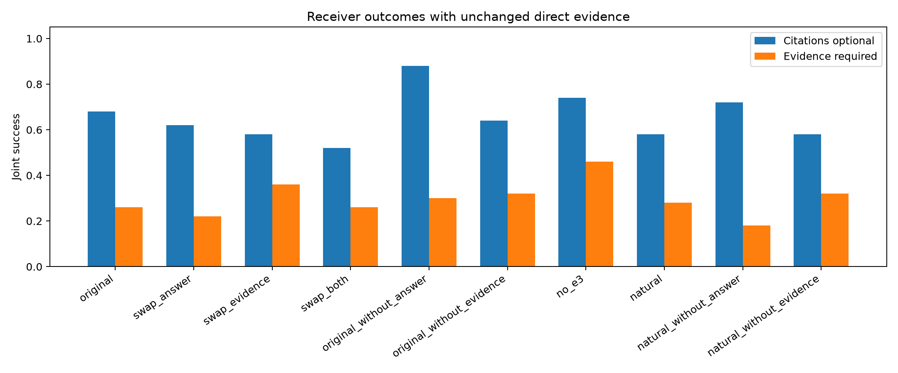
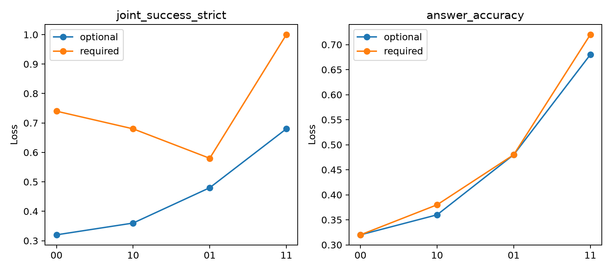
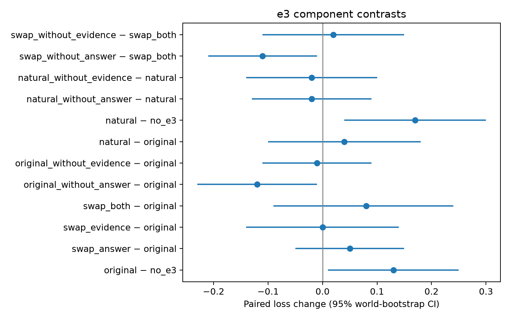

# e3干扰与需求依赖：50个全新世界机制复验

状态：完成。保持Qwen3.5-4B与原角色提示、生成设置不变；50全新正式世界、100查询、1400条件，另4个独立debug世界。正式实际节点请求 1522；本轮总请求 1646，生成token 76342，预算账本GPU时间 0.1136 小时。正式失败/截断 0/0。最终Slurm资源账单见results/resource_accounting.json（若尚无该文件，上述时间为引擎账本而非最终调度账单）。

**先回答机制问题。** e4/e5实际输出在 50/50 世界拥有程序验证的完整真实支持集合；两需求、所有e3诊断条件的直达证据hash一致，不用oracle补充漏抽。充分路径存在且no_e3成功、但带e3失败的配对实例：原始e3 21，真实上游删键后的e3 27，仅替换结论 26，仅替换证据 27（查询条件计数，非独立世界数）。这些是消息干扰的个案证据，均值与不确定性见配对表；不能把所有D错误都归于e3。

**需求改变交互：在本轮得到校正后的正向复现证据。** 严格joint loss的 J_required−J_optional=0.3200，95%世界聚类区间 [0.1200,0.5400]，Holm校正p=0.0176。以answer accuracy定义的差值为 0.0200，区间 [-0.0600,0.1000]；第一轮ID评分口径的差值为 0.3200。必须同时看这三者与拒答变化，不能仅凭严格证据评分的主效果推断行为机制。

本轮没有训练预测器，也没有第二模型；判断范围仅是证据充分性和消息对固定接收者的干扰。第一轮预测特征未据本轮结果更新。

## 设计与处理语义

50个新世界分25唯一姓名、25同名实体，两侧各5记录。资料、答案、多个充分证据集合及计划在首个模型请求前冻结。A/B/C对同一基础问题只生成一次，D的问题只在是否必须给可核验证据上不同。这是有意隔离D需求，**不是**让四个角色都响应需求的端到端复刻。两个版本必须输出相同code答案；需求变化主要关乎验证责任，而非另一道答案不同的问题。

original是真实C输出。swap_*是受控消息修改：按C已见事实的原顺序选择首个不同于C原结论的code；证据取同一候选key的已有事实。没有gold驱动选错答案，也没有伪造事实或ID；可能是与问题无关的真实证据。自然干预natural则先删e1关联键，再实际重跑C，直达e4/e5不动。删除结论使用absent，区别于C主动输出insufficient；完全屏蔽e3时D连e3键都不收到。

受控swap结论实际正确 11/50，原始C正确 25/50，natural C正确 18/50；swap noop 1，natural payload改变 50/50。全部条件保留，不只挑成功污染或baseline成功的世界。

## e3分量对照（e4/e5未改）

| demand | condition | n | joint_success | answer_accuracy | insufficient | source_evidence_sufficient | D_follows_proposal |
|---|---|---|---|---|---|---|---|
| 0 | original | 50 | 0.6800 | 0.6800 | 0.0000 | 1.0000 | 0.7600 |
| 0 | swap_answer | 50 | 0.6200 | 0.6200 | 0.0000 | 1.0000 | 0.5400 |
| 0 | swap_evidence | 50 | 0.5800 | 0.5800 | 0.0000 | 1.0000 | 0.6000 |
| 0 | swap_both | 50 | 0.5200 | 0.5200 | 0.0000 | 1.0000 | 0.2800 |
| 0 | original_without_answer | 50 | 0.8800 | 0.8800 | 0.0000 | 1.0000 | 0.0000 |
| 0 | original_without_evidence | 50 | 0.6400 | 0.6400 | 0.0000 | 1.0000 | 0.7600 |
| 0 | swap_without_answer | 50 | 0.7000 | 0.7000 | 0.0000 | 1.0000 | 0.0000 |
| 0 | swap_without_evidence | 50 | 0.5000 | 0.5000 | 0.0000 | 1.0000 | 0.5200 |
| 0 | no_e3 | 50 | 0.7400 | 0.7400 | 0.0000 | 1.0000 | 0.0000 |
| 0 | natural | 50 | 0.5800 | 0.5800 | 0.0000 | 1.0000 | 0.7200 |
| 0 | natural_without_answer | 50 | 0.7200 | 0.7200 | 0.0000 | 1.0000 | 0.0000 |
| 0 | natural_without_evidence | 50 | 0.5800 | 0.5800 | 0.0000 | 1.0000 | 0.7000 |
| 1 | original | 50 | 0.2600 | 0.6800 | 0.0000 | 1.0000 | 0.7400 |
| 1 | swap_answer | 50 | 0.2200 | 0.5800 | 0.0000 | 1.0000 | 0.5400 |
| 1 | swap_evidence | 50 | 0.3600 | 0.5600 | 0.0000 | 1.0000 | 0.5000 |
| 1 | swap_both | 50 | 0.2600 | 0.4400 | 0.0000 | 1.0000 | 0.2400 |
| 1 | original_without_answer | 50 | 0.3000 | 0.8600 | 0.0000 | 1.0000 | 0.0000 |
| 1 | original_without_evidence | 50 | 0.3200 | 0.6200 | 0.0000 | 1.0000 | 0.7000 |
| 1 | swap_without_answer | 50 | 0.3000 | 0.6200 | 0.0000 | 1.0000 | 0.0000 |
| 1 | swap_without_evidence | 50 | 0.2400 | 0.4800 | 0.0000 | 1.0000 | 0.5200 |
| 1 | no_e3 | 50 | 0.4600 | 0.6800 | 0.0000 | 1.0000 | 0.0000 |
| 1 | natural | 50 | 0.2800 | 0.6000 | 0.0000 | 1.0000 | 0.7000 |
| 1 | natural_without_answer | 50 | 0.1800 | 0.7400 | 0.0000 | 1.0000 | 0.0000 |
| 1 | natural_without_evidence | 50 | 0.3200 | 0.5600 | 0.0000 | 1.0000 | 0.7200 |

需求0=证据可选，需求1=证据必需。完整、直达证据充分/不充分子集分别在condition_metrics.csv，不能将充分子集替换全部世界主分母。

## 主要比较与配对效应

| test | n | worlds | estimate | ci_low | ci_high | p | p_holm |
|---|---|---|---|---|---|---|---|
| original_vs_no_e3 | 100 | 50 | 0.1300 | 0.0100 | 0.2500 | 0.0372 | 0.1116 |
| swap_answer_vs_original | 100 | 50 | 0.0500 | -0.0500 | 0.1500 | 0.3989 | 0.7978 |
| swap_evidence_vs_original | 100 | 50 | 0.0000 | -0.1400 | 0.1400 | 1.0000 | 1 |
| J_required_minus_optional | 50 | 50 | 0.3200 | 0.1200 | 0.5400 | 0.0044 | 0.0176 |

前三项正值代表前者增加loss；最后一项正值代表证据必需时额外组合损失更大。5000次world聚类bootstrap，同世界两个需求及全部条件绑定。四项主要检验作Holm校正；其他对照和子集为探索性。均值为0或区间跨零不等于安全或非劣。

| changed | base | n | worlds | estimate | ci_low | ci_high | harm | benefit |
|---|---|---|---|---|---|---|---|---|
| original | no_e3 | 100 | 50 | 0.1300 | 0.0100 | 0.2500 | 21 | 8 |
| swap_answer | original | 100 | 50 | 0.0500 | -0.0500 | 0.1500 | 16 | 11 |
| swap_evidence | original | 100 | 50 | 0.0000 | -0.1400 | 0.1400 | 19 | 19 |
| swap_both | original | 100 | 50 | 0.0800 | -0.0900 | 0.2400 | 27 | 19 |
| original_without_answer | original | 100 | 50 | -0.1200 | -0.2300 | -0.0100 | 7 | 19 |
| original_without_evidence | original | 100 | 50 | -0.0100 | -0.1100 | 0.0900 | 10 | 11 |
| natural | original | 100 | 50 | 0.0400 | -0.1000 | 0.1800 | 20 | 16 |
| natural | no_e3 | 100 | 50 | 0.1700 | 0.0400 | 0.3000 | 27 | 10 |
| natural_without_answer | natural | 100 | 50 | -0.0200 | -0.1300 | 0.0900 | 10 | 12 |
| natural_without_evidence | natural | 100 | 50 | -0.0200 | -0.1400 | 0.1000 | 14 | 16 |
| swap_without_answer | swap_both | 100 | 50 | -0.1100 | -0.2100 | -0.0100 | 6 | 17 |
| swap_without_evidence | swap_both | 100 | 50 | 0.0200 | -0.1100 | 0.1500 | 15 | 13 |

## e3/e5四格

00=original，10=只去e3证据但保留结论，01=去e5，11=两条证据路径同时去除。e4不变。

| metric | demand | n | worlds | L00 | L10 | L01 | L11 | estimate | ci_low | ci_high |
|---|---|---|---|---|---|---|---|---|---|---|
| joint_success_strict | 0 | 50 | 50 | 0.3200 | 0.3600 | 0.4800 | 0.6800 | 0.1600 | 0.0400 | 0.2800 |
| joint_success_strict | 1 | 50 | 50 | 0.7400 | 0.6800 | 0.5800 | 1.0000 | 0.4800 | 0.2600 | 0.7000 |
| joint_success_legacy | 0 | 50 | 50 | 0.3200 | 0.3600 | 0.4800 | 0.6800 | 0.1600 | 0.0400 | 0.2800 |
| joint_success_legacy | 1 | 50 | 50 | 0.7400 | 0.6800 | 0.5800 | 1.0000 | 0.4800 | 0.2600 | 0.7000 |
| answer_accuracy | 0 | 50 | 50 | 0.3200 | 0.3600 | 0.4800 | 0.6800 | 0.1600 | 0.0400 | 0.2800 |
| answer_accuracy | 1 | 50 | 50 | 0.3200 | 0.3800 | 0.4800 | 0.7200 | 0.1800 | 0.0400 | 0.3200 |

其中estimate=J。J为行为交互，不是互信息或普遍因果定律。各需求间配对J差见demand_interaction_difference.csv。

## 行为变化与评分变化分开

| condition | n | optional_answer_accuracy | required_answer_accuracy | optional_joint | required_joint | optional_response_scored_as_required | required_response_scored_as_optional | optional_insufficient | required_insufficient | same_D_output |
|---|---|---|---|---|---|---|---|---|---|---|
| original | 50 | 0.6800 | 0.6800 | 0.6800 | 0.2600 | 0.0800 | 0.6800 | 0.0000 | 0.0000 | 0.7200 |
| original_without_evidence | 50 | 0.6400 | 0.6200 | 0.6400 | 0.3200 | 0.2400 | 0.6200 | 0.0000 | 0.0000 | 0.7400 |
| drop_e5 | 50 | 0.5200 | 0.5200 | 0.5200 | 0.4200 | 0.2200 | 0.5200 | 0.0000 | 0.0000 | 0.7000 |
| drop_e3_evidence_and_e5 | 50 | 0.3200 | 0.2800 | 0.3200 | 0.0000 | 0.0000 | 0.2800 | 0.0000 | 0.0000 | 0.8400 |

交叉评分不重新运行LLM：同一个回答按另一证据规则评分，可显示“输出相同但评价不同”的机械部分；不同问题下真实D答案/拒答变化才属于行为部分。它不是一个独立因果中介分解。

## 证据充分性与失败归因

逐条真实来源事实按完整六字段匹配，记录一个可用支持集合witness；多个合法集合均接受。严格joint要求D引用集合中实际可见且真实的事实，而非只命中gold ID。两种评分不同的样本数 0/1400。不能把规则未找到witness当成不可恢复证明；正确proposal存在也不等于具备可核验证据。

| category | n |
|---|---|
| correct_proposal_without_source_proof | 35 |
| paired_e3_interference | 260 |
| source_proof_missing_other_information_undetermined | 96 |
| success | 625 |
| sufficient_evidence_receiver_failure | 384 |

这些类别互斥，按当前可用证据及配对no_e3结果归类。`paired_e3_interference`仅指不改变直达路径、无e3能成功而带某e3失败的配对情形；并非总体平均有害的显著性声明。`sufficient_evidence_receiver_failure`包括无e3也失败的接收者使用困难。证据不充分但结论仍可见的情况单列，不自动叫信息丢失。A/B抽取不完整导致的direct_insufficient属于前置机制限制。

## 按事前规则选择的案例

| category | world_id | demand | condition | joint_success | source_evidence_sufficient | status |
|---|---|---|---|---|---|---|
| original_interference | mechanism-formal-redundant_evidence-002 | 1 | original | 0 | 1 | N/A |
| changed_conclusion_interference | mechanism-formal-redundant_evidence-002 | 0 | swap_answer | 0 | 1 | N/A |
| changed_evidence_interference | mechanism-formal-redundant_evidence-002 | 1 | swap_evidence | 0 | 1 | N/A |
| natural_interference | mechanism-formal-redundant_evidence-003 | 0 | natural | 0 | 1 | N/A |
| remove_conclusion_rescue | mechanism-formal-redundant_evidence-003 | 0 | natural_without_answer | 1 | 1 | N/A |
| remove_evidence_rescue | mechanism-formal-redundant_evidence-003 | 0 | natural_without_evidence | 1 | 1 | N/A |
| adequate_but_no_e3_fails | mechanism-formal-redundant_evidence-001 | 0 | no_e3 | 0 | 1 | N/A |
| redundant_paths_fail | mechanism-formal-redundant_evidence-000 | 1 | drop_e3_evidence_and_e5 | 0 | 0 | N/A |
| extraction_insufficient | N/A | N/A | N/A | N/A | N/A | not observed |
| no_effect | mechanism-formal-redundant_evidence-000 | 0 | swap_both | 1 | 1 | N/A |

完整问题、gold、D前后输出、no_e3输出、证据witness、边payload和节点keys见results/cases.jsonl；按类别字典序首例，未出现则明示，不挑有利故事。

## 图与可复现性

底层CSV为condition_metrics.csv、four_cell_summary.csv、paired_contrasts.csv。执行输入输出保存在runs/formal，freeze.json与completion_audit.json验证版本与逐条件完整性。完整计划1400/1400；未重跑挑选条件、未动第一轮源码。实验只覆盖单模型、小型合成关联任务，不能保证复杂真实workflow同样表现。

## 两个预定实体命名分层（描述性）

不筛样本；共同模型在同名实体上的基线能力可能限制干扰检验。分层设计在正式前固定，以下区间未作额外多重校正。

| stratum | demand | condition | worlds | joint_success | answer_accuracy | source_sufficient |
|---|---|---|---|---|---|---|
| unique_names | 0 | natural | 25 | 0.9200 | 0.9200 | 1.0000 |
| unique_names | 0 | no_e3 | 25 | 0.8800 | 0.8800 | 1.0000 |
| unique_names | 0 | original | 25 | 0.7600 | 0.7600 | 1.0000 |
| unique_names | 0 | swap_answer | 25 | 0.5600 | 0.5600 | 1.0000 |
| unique_names | 0 | swap_evidence | 25 | 0.6800 | 0.6800 | 1.0000 |
| unique_names | 1 | natural | 25 | 0.4400 | 0.9600 | 1.0000 |
| unique_names | 1 | no_e3 | 25 | 0.6800 | 0.8400 | 1.0000 |
| unique_names | 1 | original | 25 | 0.3200 | 0.7600 | 1.0000 |
| unique_names | 1 | swap_answer | 25 | 0.2800 | 0.4800 | 1.0000 |
| unique_names | 1 | swap_evidence | 25 | 0.4800 | 0.6000 | 1.0000 |
| shared_names | 0 | natural | 25 | 0.2400 | 0.2400 | 1.0000 |
| shared_names | 0 | no_e3 | 25 | 0.6000 | 0.6000 | 1.0000 |
| shared_names | 0 | original | 25 | 0.6000 | 0.6000 | 1.0000 |
| shared_names | 0 | swap_answer | 25 | 0.6800 | 0.6800 | 1.0000 |
| shared_names | 0 | swap_evidence | 25 | 0.4800 | 0.4800 | 1.0000 |
| shared_names | 1 | natural | 25 | 0.1200 | 0.2400 | 1.0000 |
| shared_names | 1 | no_e3 | 25 | 0.2400 | 0.5200 | 1.0000 |
| shared_names | 1 | original | 25 | 0.2000 | 0.6000 | 1.0000 |
| shared_names | 1 | swap_answer | 25 | 0.1600 | 0.6800 | 1.0000 |
| shared_names | 1 | swap_evidence | 25 | 0.2400 | 0.5200 | 1.0000 |

| stratum | changed | base | n | worlds | estimate | ci_low | ci_high |
|---|---|---|---|---|---|---|---|
| unique_names | original | no_e3 | 50 | 25 | 0.2400 | 0.0800 | 0.4000 |
| unique_names | swap_answer | original | 50 | 25 | 0.1200 | -0.0400 | 0.2800 |
| unique_names | swap_evidence | original | 50 | 25 | -0.0400 | -0.2400 | 0.1600 |
| unique_names | natural | original | 50 | 25 | -0.1400 | -0.3200 | 0.0200 |
| unique_names | natural_without_answer | natural | 50 | 25 | 0.0600 | -0.0800 | 0.2000 |
| unique_names | natural_without_evidence | natural | 50 | 25 | -0.0400 | -0.2400 | 0.1600 |
| shared_names | original | no_e3 | 50 | 25 | 0.0200 | -0.1400 | 0.1800 |
| shared_names | swap_answer | original | 50 | 25 | -0.0200 | -0.1400 | 0.1000 |
| shared_names | swap_evidence | original | 50 | 25 | 0.0400 | -0.1400 | 0.2200 |
| shared_names | natural | original | 50 | 25 | 0.2200 | 0.0200 | 0.4200 |
| shared_names | natural_without_answer | natural | 50 | 25 | -0.1000 | -0.2600 | 0.0600 |
| shared_names | natural_without_evidence | natural | 50 | 25 | 0.0000 | -0.1400 | 0.1400 |

## 机制解读：哪些可以解释，哪些仍不能（事后描述性补充）

**证据不足不是完整直达路径下的解释。** 所有50世界的e4/e5都有真实充分来源集合；该组失败属于接收者没有正确利用信息，或被e3改变了行为。屏蔽e3后仍有 29/100 查询答案错误，因此“e3干扰”也不能解释全部错误。

**显式结论更像答案错误的一项来源，但不能说是唯一来源。** 保留e3证据、仅删除显式结论，答案正确率由 68% 升到 87%，配对增益 0.190，95%world区间 [0.080,0.310]。仅删除e3证据时答案正确率 63%；完全屏蔽e3为 71%。这是探索性端点分析，不替代四项主检验；原始e3相对no_e3的平均joint损害经过Holm校正未显著（p=0.112）。受控swap的原结论本来就有一半错误，swap也并非总是变坏，应看成对损害/改善数，不能把其均值小解释成D对错误结论免疫。

**答案正确与引用完整是两种不同失败。** 证据必需的50查询里，原始e3有 34 个正确答案、仅 13 个joint成功；删除结论后正确答案增加到 43，但joint仅 15。完全屏蔽e3时分别为 34 和 23。所以保留C证据、去掉结论对答案有帮助，却没有同步解决来源核验；也不能据此制定“永远删结论、永远留证据”的规则。

| condition | n | answer_accuracy | joint_success | required_answer_correct | required_joint_correct | required_correct_answer_but_incomplete_citations |
|---|---|---|---|---|---|---|
| original | 100 | 0.6800 | 0.4700 | 34 | 13 | 21 |
| original_without_answer | 100 | 0.8700 | 0.5900 | 43 | 15 | 28 |
| original_without_evidence | 100 | 0.6300 | 0.4800 | 31 | 16 | 15 |
| no_e3 | 100 | 0.7100 | 0.6000 | 34 | 23 | 11 |
| natural | 100 | 0.5900 | 0.4300 | 30 | 14 | 16 |
| natural_without_answer | 100 | 0.7300 | 0.4500 | 37 | 9 | 28 |
| natural_without_evidence | 100 | 0.5700 | 0.4500 | 28 | 16 | 12 |

**需求交互复现主要落在证据达标这个端点。** 按loss恒等式，ΔJ_joint=ΔJ_answer+引用未达标项，本轮均值为0.32=0.02+0.30。它是指标分解，不是因果中介分解；答案交互的需求差异区间跨零。证据双路径都去掉后，必需需求下50/50没有来源证明，joint为0，但模型仍有14/50答案碰巧或借proposal正确；50/50均未输出insufficient。这表明固定D还存在“缺证据却不拒答/不给出完整支持”的协议执行问题，不能仅以信息是否可恢复概括。

| component | n | worlds | estimate | ci_low | ci_high |
|---|---|---|---|---|---|
| joint_demand_interaction | 50 | 50 | 0.3200 | 0.1200 | 0.5400 |
| answer_demand_interaction | 50 | 50 | 0.0200 | -0.0600 | 0.1000 |
| citation_component | 50 | 50 | 0.3000 | 0.1200 | 0.5000 |

两条单独删边之后都仍有真实证据证明的世界只有 26/50（原始C未必转述完整证据）；因此全部四格混合了真正双备份与原本只靠直达路径的世界。事后对这个纯结构充分性子集的复验：ΔJ=0.654，区间[0.385,0.923]，仅探索性；主分母仍为50世界，没有换成这个子集。

**下一步最有价值的一项验证**：保持模型和新世界生成规则，比较原D与一个固定“先按entity key从来源事实形成project–code支持对、再输出答案及这对ID”的D协议。保留本轮e3分量对照；同时检查答案和真实来源配对，不再只看裸答案或citation ID。先验证该接收者核验程序能否减少错误结论干扰及引用遗漏，再考虑预测特征或第二模型。本轮没有执行这一新方案。

最终资源：两个Slurm作业均COMPLETED，本轮 1646 请求、76342 生成token、409 GPU秒（0.1136小时）；单卡B300。所有主检验代码/数据哈希保持冻结版本；本节标为事后解释，相关CSV和脚本独立保存。
