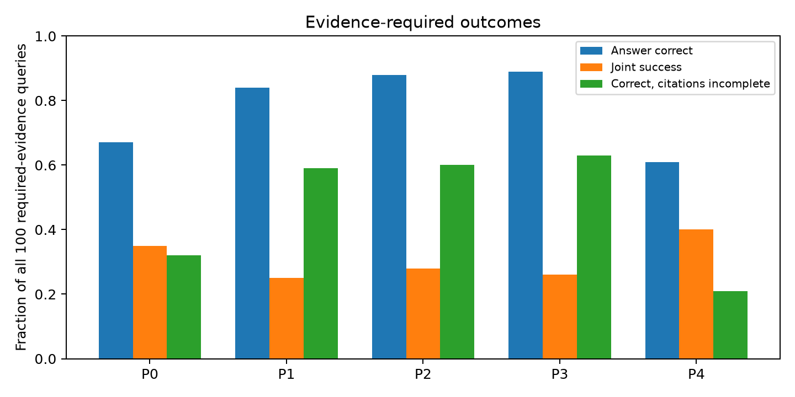
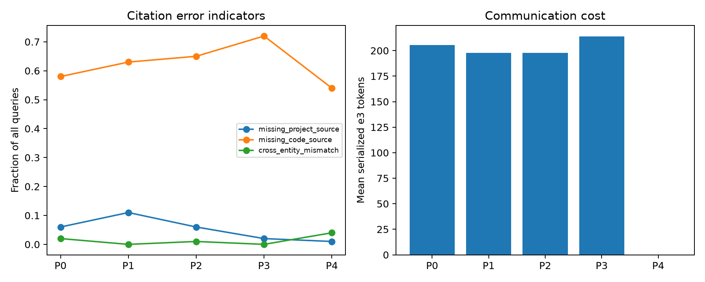
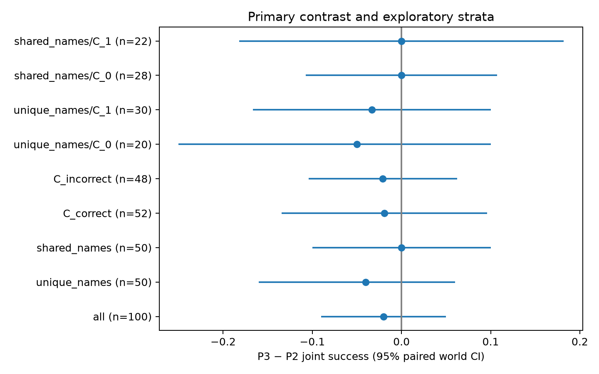

# e3消息组织方式：100个全新世界的协议干预

已完成100世界、200查询、1000/1000条件；保持Qwen3.5-4B、D及其他角色提示、workflow不变。正式实际请求1118，含4个debug世界共1162请求、77122生成token；单GPU累计490.00秒（Slurm最终账单）。正式解析失败0、截断0。所有样本保留。

**主要答案：** 证据必需时P3−P2联合成功率差为-0.020，95%世界配对区间[-0.090,+0.050]；改善6世界、损害8世界，精确双侧McNemar p=0.7905。主分母100个世界，不筛基线成功或C正确。P2/P3相对P1均有正向点估计，但分组独立收益须以主区间为准；若跨零，则与顺序解释相容，不能声称等效或独立分组收益。

## 五协议及受控范围

P0原消息；P1仅删结论；P2在P1上按entity key稳定排序平铺证据；P3使用P2完全相同的事实和展开顺序，加entity_key/records分组外层；P4完全屏蔽e3。P3每条事实仍保留原六字段和来源id，未增加或计算支持事实。support_links在P1/P2/P3一致。所有100世界均验证展开P3逐条等于P2，重复事实也保留。e4/e5在所有条件完全不变，两需求payload hash相同。

仅从原e3转换，不访问gold、问题或另一边；D提示及公共说明没有增加分组解读提示。P3同时增加JSON结构、重复key及token，因此检验的是此具体组织方式，不是排除一切表达因素的抽象关系效应。

50唯一姓名、50同名世界；每侧5条记录、有多个合法支持集合。新数据与前两轮实体key/name/project/code无交集。A/B/C每世界共享一次基础问题执行，只在D问题改变证据需求。同世界需求版本并非独立样本。

## 证据必需：全部100查询

| condition | n | answer_accuracy | joint_success | correct_answer_incomplete | correct_n | correct_incomplete_n | incomplete_given_correct | citation_complete | insufficient |
|---|---|---|---|---|---|---|---|---|---|
| P0 | 100 | 0.6700 | 0.3500 | 0.3200 | 67 | 32 | 0.4776 | 0.3800 | 0.0000 |
| P1 | 100 | 0.8400 | 0.2500 | 0.5900 | 84 | 59 | 0.7024 | 0.2700 | 0.0000 |
| P2 | 100 | 0.8800 | 0.2800 | 0.6000 | 88 | 60 | 0.6818 | 0.2900 | 0.0000 |
| P3 | 100 | 0.8900 | 0.2600 | 0.6300 | 89 | 63 | 0.7079 | 0.2600 | 0.0000 |
| P4 | 100 | 0.6100 | 0.4000 | 0.2100 | 61 | 21 | 0.3443 | 0.4600 | 0.0000 |

correct_answer_incomplete分母是全部100题；incomplete_given_correct才以正确答案为分母。joint要求正确答案与实际可见、真实、完整来源集合；多个合法证据集合都认可。额外无关引用单报，不改变沿用的成功定义。

## 配对差与通信成本

| changed | base | metric | n | estimate | ci_low | ci_high | increases | decreases |
|---|---|---|---|---|---|---|---|---|
| P3 | P2 | joint_success | 100 | -0.0200 | -0.0900 | 0.0500 | 6 | 8 |
| P3 | P2 | answer_accuracy | 100 | 0.0100 | -0.0200 | 0.0500 | 2 | 1 |
| P3 | P2 | correct_answer_incomplete | 100 | 0.0300 | -0.0500 | 0.1100 | 10 | 7 |
| P1 | P0 | joint_success | 100 | -0.1000 | -0.1900 | -0.0100 | 7 | 17 |
| P1 | P0 | answer_accuracy | 100 | 0.1700 | 0.1000 | 0.2400 | 17 | 0 |
| P1 | P0 | correct_answer_incomplete | 100 | 0.2700 | 0.1600 | 0.3800 | 32 | 5 |
| P2 | P1 | joint_success | 100 | 0.0300 | 0.0000 | 0.0700 | 3 | 0 |
| P2 | P1 | answer_accuracy | 100 | 0.0400 | 0.0100 | 0.0800 | 4 | 0 |
| P2 | P1 | correct_answer_incomplete | 100 | 0.0100 | -0.0300 | 0.0500 | 3 | 2 |
| P3 | P1 | joint_success | 100 | 0.0100 | -0.0600 | 0.0800 | 8 | 7 |
| P3 | P1 | answer_accuracy | 100 | 0.0500 | 0.0000 | 0.1100 | 6 | 1 |
| P3 | P1 | correct_answer_incomplete | 100 | 0.0400 | -0.0500 | 0.1300 | 12 | 8 |
| P2 | P0 | joint_success | 100 | -0.0700 | -0.1700 | 0.0300 | 10 | 17 |
| P2 | P0 | answer_accuracy | 100 | 0.2100 | 0.1300 | 0.2900 | 21 | 0 |
| P2 | P0 | correct_answer_incomplete | 100 | 0.2800 | 0.1600 | 0.3900 | 35 | 7 |
| P3 | P0 | joint_success | 100 | -0.0900 | -0.2000 | 0.0100 | 10 | 19 |
| P3 | P0 | answer_accuracy | 100 | 0.2200 | 0.1400 | 0.3000 | 22 | 0 |
| P3 | P0 | correct_answer_incomplete | 100 | 0.3100 | 0.1900 | 0.4300 | 38 | 7 |
| P3 | P4 | joint_success | 100 | -0.1400 | -0.2500 | -0.0300 | 10 | 24 |
| P3 | P4 | answer_accuracy | 100 | 0.2800 | 0.1900 | 0.3800 | 30 | 2 |
| P3 | P4 | correct_answer_incomplete | 100 | 0.4200 | 0.3000 | 0.5300 | 48 | 6 |

仅P3−P2的required joint为预指定主检验；其他差、端点、分层均探索性。5000次世界配对bootstrap，相同抽样种子，需求和条件绑定；正差对于correct_answer_incomplete代表变差。一个主要检验无需多重主要检验校正；不以次要显著性代替主要结论。

| condition | e3_tokens | downstream_tokens | total_edge_tokens | D_input_tokens | D_output_tokens |
|---|---|---|---|---|---|
| P0 | 205.4000 | 842.8200 | 1480.2400 | 1272.7700 | 35.0900 |
| P1 | 197.6100 | 835.0300 | 1472.4500 | 1264.9800 | 32.4600 |
| P2 | 197.6100 | 835.0300 | 1472.4500 | 1264.9800 | 32.5900 |
| P3 | 213.7900 | 851.2100 | 1488.6300 | 1281.1600 | 31.9900 |
| P4 | 0.0000 | 637.4200 | 1274.8400 | 1064.3700 | 34.9900 |

e3_tokens为实际tokenizer对线上序列化payload计数，downstream=e3/e4/e5，total_edge_tokens为五边之和，D_input_tokens为实际chat template输入。独立边token之和与完整prompt token不同，不混用。缓存节省推理请求，但通信比较按每次部署协议完整边通信计量，未靠删除事实匹配长度。

## 引用错误（可重叠标签）

| condition | error | count | denominator | among_incomplete_count | incomplete_denominator |
|---|---|---|---|---|---|
| P0 | missing_project_source | 6 | 100 | 6 | 62 |
| P0 | missing_code_source | 58 | 100 | 58 | 62 |
| P0 | missing_both | 2 | 100 | 2 | 62 |
| P0 | cross_entity_mismatch | 2 | 100 | 2 | 62 |
| P0 | wrong_target_pair | 1 | 100 | 0 | 62 |
| P0 | unknown_source_id | 1 | 100 | 0 | 62 |
| P0 | unverified_visible_source | 0 | 100 | 0 | 62 |
| P0 | unrelated_source_id | 6 | 100 | 2 | 62 |
| P1 | missing_project_source | 11 | 100 | 11 | 73 |
| P1 | missing_code_source | 63 | 100 | 63 | 73 |
| P1 | missing_both | 1 | 100 | 1 | 73 |
| P1 | cross_entity_mismatch | 0 | 100 | 0 | 73 |
| P1 | wrong_target_pair | 1 | 100 | 0 | 73 |
| P1 | unknown_source_id | 0 | 100 | 0 | 73 |
| P1 | unverified_visible_source | 0 | 100 | 0 | 73 |
| P1 | unrelated_source_id | 3 | 100 | 1 | 73 |
| P2 | missing_project_source | 6 | 100 | 6 | 71 |
| P2 | missing_code_source | 65 | 100 | 65 | 71 |
| P2 | missing_both | 0 | 100 | 0 | 71 |
| P2 | cross_entity_mismatch | 1 | 100 | 1 | 71 |
| P2 | wrong_target_pair | 0 | 100 | 0 | 71 |
| P2 | unknown_source_id | 0 | 100 | 0 | 71 |
| P2 | unverified_visible_source | 0 | 100 | 0 | 71 |
| P2 | unrelated_source_id | 2 | 100 | 1 | 71 |
| P3 | missing_project_source | 2 | 100 | 2 | 74 |
| P3 | missing_code_source | 72 | 100 | 72 | 74 |
| P3 | missing_both | 0 | 100 | 0 | 74 |
| P3 | cross_entity_mismatch | 0 | 100 | 0 | 74 |
| P3 | wrong_target_pair | 0 | 100 | 0 | 74 |
| P3 | unknown_source_id | 0 | 100 | 0 | 74 |
| P3 | unverified_visible_source | 0 | 100 | 0 | 74 |
| P3 | unrelated_source_id | 0 | 100 | 0 | 74 |
| P4 | missing_project_source | 1 | 100 | 1 | 54 |
| P4 | missing_code_source | 54 | 100 | 54 | 54 |
| P4 | missing_both | 1 | 100 | 1 | 54 |
| P4 | cross_entity_mismatch | 4 | 100 | 4 | 54 |
| P4 | wrong_target_pair | 1 | 100 | 0 | 54 |
| P4 | unknown_source_id | 0 | 100 | 0 | 54 |
| P4 | unverified_visible_source | 0 | 100 | 0 | 54 |
| P4 | unrelated_source_id | 7 | 100 | 5 | 54 |

缺project/code指未引用可验证且支持目标答案的该类来源；跨实体不匹配指引用两类真实事实但无共同key，不推断模型内部意图；错误目标配对单列。未知ID与真实但未在消息中可验证的ID分开。多标签可以重叠，不能相加为总错误率。完整真实直达支持存在100/100世界；其余世界亦保留主分析，未用oracle补抽取。

## 预指定辅助分层：P3−P2的required联合成功

| stratum | n | estimate | ci_low | ci_high | increases | decreases |
|---|---|---|---|---|---|---|
| all | 100 | -0.0200 | -0.0900 | 0.0500 | 6 | 8 |
| unique_names | 50 | -0.0400 | -0.1600 | 0.0600 | 3 | 5 |
| shared_names | 50 | 0.0000 | -0.1000 | 0.1000 | 3 | 3 |
| C_correct | 52 | -0.0192 | -0.1346 | 0.0962 | 4 | 5 |
| C_incorrect | 48 | -0.0208 | -0.1042 | 0.0625 | 2 | 3 |
| unique_names/C_0 | 20 | -0.0500 | -0.2500 | 0.1000 | 1 | 2 |
| unique_names/C_1 | 30 | -0.0333 | -0.1667 | 0.1000 | 2 | 3 |
| shared_names/C_0 | 28 | 0.0000 | -0.1071 | 0.1071 | 1 | 1 |
| shared_names/C_1 | 22 | 0.0000 | -0.1818 | 0.1818 | 2 | 2 |

原C正确52/100，P2实际重排9/100，P3含至少一个多记录组96/100。C正误只在离线分析定义，不能用于运行选择。没有可合并事实的世界也保留。

## 证据可选需求

| condition | n | answer_accuracy | joint_success | correct_answer_incomplete | citation_complete | insufficient |
|---|---|---|---|---|---|---|
| P0 | 100 | 0.6600 | 0.6600 | 0.4200 | 0.2700 | 0.0000 |
| P1 | 100 | 0.8500 | 0.8500 | 0.6700 | 0.2100 | 0.0000 |
| P2 | 100 | 0.8900 | 0.8900 | 0.7000 | 0.2000 | 0.0000 |
| P3 | 100 | 0.9000 | 0.9000 | 0.6800 | 0.2200 | 0.0000 |
| P4 | 100 | 0.6900 | 0.6900 | 0.3100 | 0.4600 | 0.0000 |

## 案例、审计与限制

| category | world_id | status |
|---|---|---|
| P3_rescues_P2 | organization-formal-redundant_evidence-002 | observed |
| P3_harms_P2 | organization-formal-redundant_evidence-003 | observed |
| P2_rescues_P1 | organization-formal-redundant_evidence-004 | observed |
| P1_rescues_P0 | organization-formal-redundant_evidence-003 | observed |
| P3_repairs_citation_only | organization-formal-redundant_evidence-002 | observed |
| P3_answer_only_incomplete | organization-formal-redundant_evidence-062 | observed |
| P3_repairs_cross_entity_citation | N/A | not observed |
| P4_beats_P3 | organization-formal-redundant_evidence-000 | observed |
| all_success | organization-formal-redundant_evidence-014 | observed |
| all_failure | organization-formal-redundant_evidence-001 | observed |

cases.jsonl保存按冻结规则所取首例的五协议输入、输出、gold、来源审计、payload及节点hash；sample_metrics.csv包含全部1000样本。主结果并不只来自这些案例。

freeze.json锁定协议/数据/评分/提示；formal_audit.json验证每条真实D输入、需求payload一致、上游复用、e4/e5不变、P2/P3完全可逆、模型代码hash、全部条件覆盖。正式调用角色数：{'A': 100, 'B': 100, 'C': 100, 'D': 818}；最大实际输入/输出token：1700/231。旧实验文件未修改。debug原始答案准确率0.750，只用于格式/实现检查，不按测试调格式。

本实验单模型、100个合成关联世界，依赖C实际输出的有限证据；不保证真实长文本上复现。没有证明最小协议，也没有训练预测器。下一步按上面决策执行，本轮未追加格式消融、未改变D核验提示。

底层数据：condition_metrics.csv、citation_errors.csv、paired_comparisons.csv。运行与重新统计命令见README.md。
